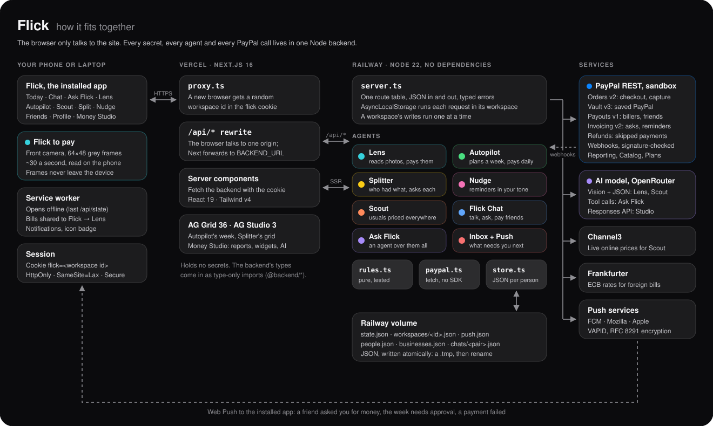
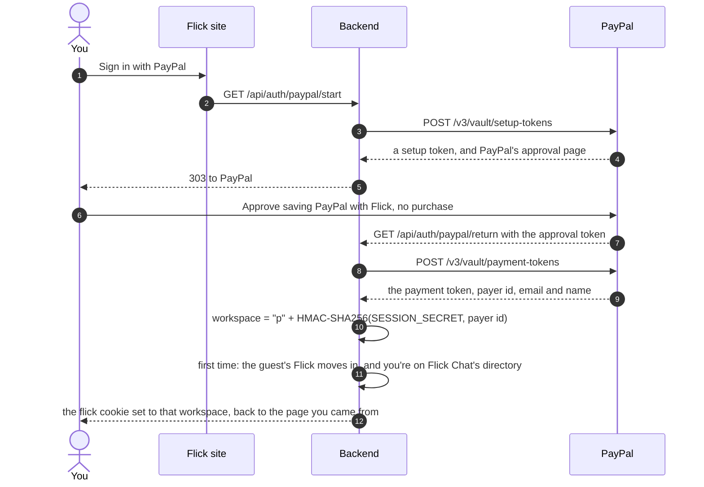
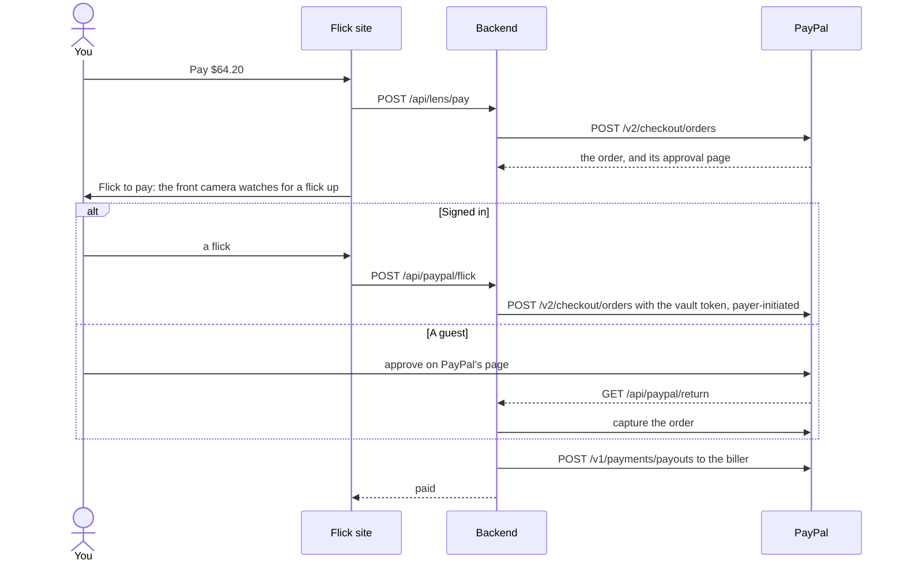
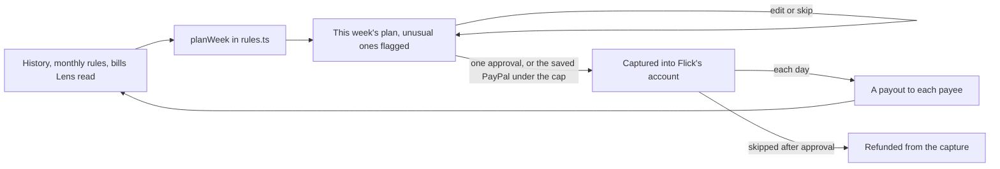
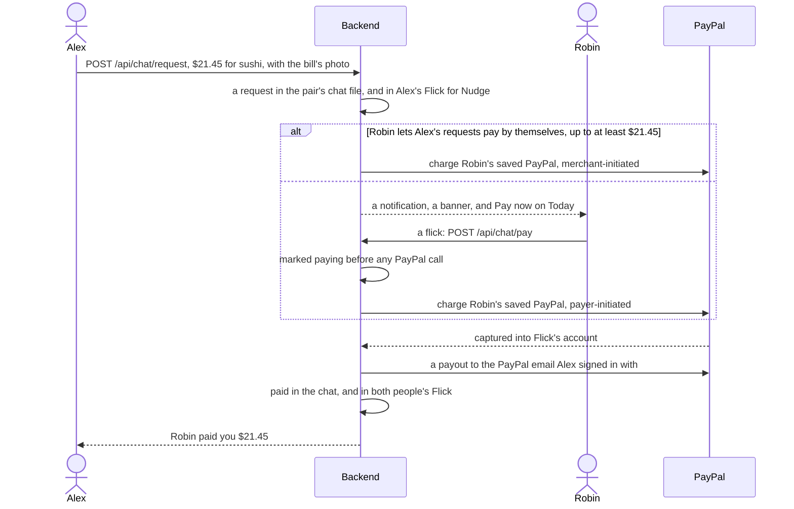
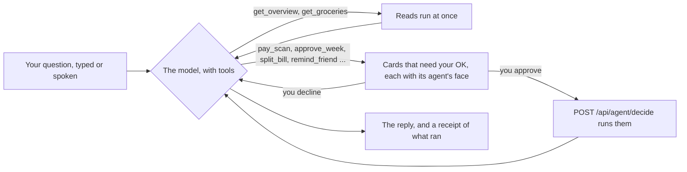
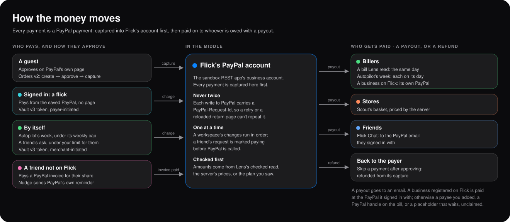

<div align="center">


# Flick

### Flick the camera at something and it's paid

[](#paypal-integration)
[](#ai-and-its-guard-rails)
[](#money-studio)
[](frontend/)
[](backend/)
[](#the-installed-app)

**Flick is a payments app run by a team of AI agents on PayPal. Point your phone at a bill, a
receipt, a price tag or a tip jar, or share it an e-bill, and Lens reads it. Flick a finger at the
front camera and it's paid from your saved PayPal. Autopilot learns what you pay and runs each week
on one approval; Splitter and Flick Chat get friends to pay you back; Scout buys your usual
groceries where they're cheapest; Safe keeps money given for one thing spent on that thing; and Ask
Flick plans across all of them, typed or spoken.**

[Open Flick](https://www.flickit.site) · [Install it](https://www.flickit.site/install) · [Architecture](#architecture) · [How the money moves](#how-the-money-moves) · [Partner evidence](partner-docs/) · [Run it](#run-and-verify)

Built for the [PayPal AI Hackathon](https://paypalaihackathon.devpost.com), on PayPal's sandbox.



</div>

---

## The gap

Paying for things is still mostly typing: a payee, an amount, a date, a password, again and again.
The AI part of most money apps is a chat box beside the same forms.

| Moment | What it takes today | What Flick does |
|---|---|---|
| **A bill arrives** | Paper, a PDF or an e-mail. You retype the payee, the amount and the due date into a banking app. | Lens reads a photo, a PDF or an e-mail with a vision model into a strict JSON schema; rules check it; a flick pays it. |
| **Whose account is it?** | A bill names a business, not a PayPal account. | Businesses register on Flick with the PayPal they sign in with. A bill with their name pays that account, and Lens says so before you pay. |
| **The same payments every week** | Blind autopay, or a chore each time. | Autopilot plans the week only from what it has seen, flags anything unusual, and takes one approval for the week, or pays by itself under a cap. |
| **Getting paid back** | Maths on a receipt, then chasing people. | Splitter works out shares to the cent. Friends on Flick pay in Flick Chat with a flick, or by themselves under a limit; anyone else gets a PayPal invoice, and Nudge reminds them. |
| **Groceries** | Prices move every week, store to store. | Scout learns your usuals, prices them at every store, sees prices coming, and buys the basket in one checkout. |
| **Money for one thing** | You send money for chocolates, or school books, and it's spent on anything. A receipt proves nothing: it could be old, edited or already used. | Safe holds it. The friend snaps the receipt; only the lines for that purpose come out, each receipt only once, and anything doubtful waits for you. What's left is refunded to you. |
| **Saying yes** | A password and a redirect for every payment. | One finger flicked up at the front camera, read on the phone. Signed in, it charges your saved PayPal with no page. |

**Our position:** AI reads and proposes, rules check, a person approves, and PayPal moves the money.
No model ever sets an amount, chooses who's paid, or pays anything on its own.

## The product in one payment

~~~text
a photo, PDF or e-mail of a bill → Lens reads it (vision model, strict JSON schema)
  → rules.ts checks it → who's paid: a business on Flick, or a payee you know
  → a flick at the front camera → PayPal: a capture, or a charge to your saved PayPal
  → a payout to the biller the same day → Autopilot learns it
  → next week's plan, unusual payments flagged → one approval, or paid by itself under the cap
~~~

<table>
<tr>
<td width="33%"><b>1. Snap it</b><br/>Lens reads a bill, receipt, price tag or tip jar from the camera, an e-bill's PDF, or an e-mail shared to Flick. A bill in another currency is converted at the day's ECB rate, and the scan keeps what it said.</td>
<td width="33%"><b>2. Flick it</b><br/>A finger flicked up at the front camera confirms. Signed in with PayPal, that charges your saved PayPal (PayPal's vault) straight away; as a guest, PayPal's approval page opens.</td>
<td width="33%"><b>3. Forget it</b><br/>Ask, and Autopilot pays that bill every month from now on, with your weekly habits, on one approval a week, or by itself under the cap you set.</td>
</tr>
</table>

### What Flick keeps, and what it never sees

| Kept in your Flick (your workspace) | Never kept, or never leaves where it is |
|---|---|
| What Lens read, and the photos of your newest 10 scans (about 40 KB each) | The camera frames that read your flick: compared on the phone, never sent |
| Your saved PayPal's vault token, on the server only (the browser gets an empty string) | Your PayPal password: you sign in on PayPal's own page |
| Friends by their PayPal email; chat messages (the newest 300 a chat, photos on the newest 10) | PayPal's credentials and the AI key: the backend's environment only |
| What each agent did (the newest 200 lines) | Photos in other prompts: Ask Flick and Money Studio get fields, not photos |

---

## Architecture

| Diagram | What it covers |
|---|---|
| [Architecture](diagrams/architecture.svg) | The installed app, the Next.js site, the Node backend with its agents and storage, and the services it calls. |
| [How the money moves](diagrams/money.svg) | Who pays and how they approve, Flick's PayPal account in the middle, and who gets paid. |
| [Signing in with PayPal](#signing-in-with-paypal) | PayPal's vault as the login. |
| [Flick to pay](#flick-to-pay) | The guest path and the signed-in path. |
| [Autopilot's week](#autopilot) | Plan, approve once, pay each day, learn. |
| [Flick Chat](#flick-chat) | A request with a bill's photo, paid with a flick or by itself. |
| [Ask Flick](#ask-flick) | Read, propose, approve, act. |
| [PayPal webhooks](#paypal-webhooks) | Verified with PayPal, then applied to whoever they're about. |

| Layer | Crux | Technical implementation |
|---|---|---|
| **Client** | A phone app without an app store. | Next.js 16 pages as an installable PWA: a manifest with shortcuts and a share target (photos, PDFs, an e-mail's text), a service worker per build (offline pages, shared bills, Web Push), and the flick gesture from front-camera frame differencing. |
| **Edge** | The browser never holds a secret or calls another origin. | Vercel. [`proxy.ts`](frontend/proxy.ts) gives each new browser a random workspace id in an HttpOnly cookie; `/api/*` is rewritten to the backend, so it's same-origin with no CORS; server components fetch with the cookie. Backend types come in as type-only imports. |
| **API** | Many people, one process, no payment twice. | Node 22 running TypeScript directly (type stripping): no build, zero runtime dependencies. One route table; `AsyncLocalStorage` runs each request in its workspace; each workspace's writes run one at a time. Typed JSON errors. |
| **Agents** | AI that can't move money on its own. | Lens, Autopilot, Splitter, Nudge, Scout, Safe, Flick Chat and Ask Flick, over pure, tested rules ([`rules.ts`](backend/src/rules.ts), [`scout-rules.ts`](backend/src/scout-rules.ts), [`safe-rules.ts`](backend/src/safe-rules.ts)). Model output is untrusted until checked. |
| **Money** | Every payment is a real PayPal call, safe to retry. | [`paypal.ts`](backend/src/paypal.ts): plain `fetch`, OAuth client credentials cached until a minute before expiry, a `PayPal-Request-Id` on every write, retries with backoff on 401, 429 and 5xx only for writes that carry one. Orders v2, Vault v3, Payouts v1, Invoicing v2, refunds, verified webhooks. |
| **Identity** | Signing in without a password of Flick's own. | PayPal's vault is the login: a setup token approved on PayPal's page proves the account, and the workspace id is an HMAC of PayPal's payer id. |
| **Storage** | Simple and crash-safe at a hackathon's scale. | A JSON file per workspace, plus shared `people.json`, `businesses.json`, `chats/<pair>.json` (with their Safes), `receipts.json` and `push.json`, on a Railway volume, each written atomically (a `.tmp`, then rename). |
| **Notifications** | Tell people what needs them, without a library. | Web Push with VAPID (RFC 8292) and aes128gcm encryption (RFC 8291, tested against the RFC's own example); in-app banners and unread counts from a 5-second poll. |

### A request, end to end

1. The app calls `/api/…` on its own origin. On a browser's first visit, [`proxy.ts`](frontend/proxy.ts) makes a workspace id (a random UUID) and sets it as the `flick` cookie: HttpOnly, SameSite=Lax, Secure on HTTPS, for a year.
2. Vercel rewrites `/api/*` to the backend on Railway (`BACKEND_URL`), cookie and all.
3. [`server.ts`](backend/src/server.ts) looks the route up in one table (`'POST /api/chat/pay'`), takes the workspace from the cookie (it must match `^[A-Za-z0-9_-]{16,64}$`, so it can never name a file outside its folder), and runs the handler inside `inWorkspace(id)`. The `state` every agent reads and writes is now that person's.
4. A write waits for that workspace's previous writes to finish, so two quick taps can never pay the same thing twice. The AI proxy, which streams, and webhooks, which lock the workspace they turn out to be about, are the two exceptions.
5. The agent checks its input (`need()`), calls PayPal with an idempotency key, updates `state`, logs what it did, and `save()` writes the workspace atomically.
6. The answer is JSON. Errors are `{ "error": { "message" } }`: 400 bad input, 401 needs signing in, 402 PayPal turned down a saved PayPal, 404 unknown id, 409 the state doesn't allow it, 413 too big, 429 the AI's hourly limit, 502 PayPal or the model failed, 503 a key isn't set.

### Signing in with PayPal

There's no password of Flick's own. One approval on PayPal's page saves your PayPal with Flick
(PayPal's vault, with no purchase), and that payment token says both who you are and how you pay.
Your workspace is keyed from your PayPal account with the server's secret, so signing in on any
device opens the same Flick. The first time, what you did as a guest in that browser moves in with
you. Signing in is optional: a guest can do everything, approving each payment on PayPal's page.



### Flick to pay

Every payment asks for one finger flicked up in front of the phone's front camera
([`flick-confirm.tsx`](frontend/components/flick-confirm.tsx)). The browser compares tiny 64×48
grey frames about 30 times a second ([`lib/flick.ts`](frontend/lib/flick.ts), tested): a flick is
movement over at least three frames, a finger's worth (not the whole picture, as when the camera
adjusts its exposure), whose centre rises a good part of the frame and more than it moves sideways.
The camera is read, never shown, and frames never leave the phone. With no camera, or no
permission, a tap does it.



---

## The agents

Each agent is a module over the same workspace. Their colours and faces are the app's: Lens cyan,
Autopilot green, Splitter yellow, Nudge pink, Scout orange, Safe blue, Ask Flick violet. The working pages show
only your own things, or an empty state that says how to start; the one-pager at `/` is the demo.

### Lens

[`lens.ts`](backend/src/lens.ts) · `/lens`

- **Reads** one of: a photo (JPEG, PNG, WebP, GIF or HEIC, as a data URL, with a 480 px copy to keep), an e-bill's PDF (5 MB at most, sent to the model as a `file` part), or a bill as text, such as an e-mail (10 to 20,000 characters).
- **Asks the model** (`AI_MODEL`, `google/gemini-2.5-flash` on OpenRouter unless set, with fallbacks listed after it) for a strict JSON schema: kind (bill, receipt, product, tip, unknown), title, summary, amount, currency, due date, whether it repeats, a PayPal handle, line items, tax, tip, and the fields a person would check. The prompt says to report only what's there and never guess an amount.
- **Checks it** ([`checkLens`](backend/src/rules.ts)): model output is untrusted, so malformed values are dropped, unreadable amounts become 0, and an unknown kind can't be paid.
- **Currency:** the model reads it from the symbol, or from the address, phone code, tax and language when a "$" is ambiguous. Anything not in USD is converted at the day's ECB rate ([Frankfurter](https://frankfurter.dev), cached six hours); the scan keeps the original, shown as "₹801.00 ($8.53)".
- **Who's paid:** a [business registered on Flick](#businesses-on-flick) whose name is on the bill, as whole words (the longest name wins), is paid at its own PayPal. Otherwise, a payee Flick already knows, the PayPal email the bill shows, or a placeholder whose payout waits, unclaimed. It's worked out again at paying, and Lens shows it before you pay.
- **Pays:** one checkout (or a flick), captured into Flick's account, then a payout to the payee the same day. "Every month" makes it a monthly rule for Autopilot. A receipt can go to Splitter instead. A bill due this week joins Autopilot's plan.
- **Shared to Flick:** on Android, a photo, an e-bill's PDF or an e-mail shared to Flick lands in Lens. On iPhone, where home-screen apps can't be shared to, *Upload an e-bill* opens the phone's files.

### Autopilot

[`autopilot.ts`](backend/src/autopilot.ts), rules in [`rules.ts`](backend/src/rules.ts) · `/autopilot`



- **Plans only what it has seen**, each payment with its reason: bills Lens read that fall due this week; monthly payments, set up or learned (paid within two days of the same day of the month in two of the three months before); and weekly habits (the same payee on the same weekday in three of the four weeks before). It never invents a payee or an amount, and pays a payee at most once a day.
- **Flags the unusual:** a payee Flick has never paid, or an amount at least 25% above that payee's average of two or more past payments ("27% above usual"), before you approve.
- **One approval a week:** a single Orders v2 checkout with an item per payment. Tick *Save PayPal* and the capture also saves your PayPal (`store_in_vault: ON_SUCCESS`, `usage_type: MERCHANT`). From then on each week is charged to it as a merchant-initiated payment (`stored_credential.payment_initiator: MERCHANT`), up to the weekly cap ($200 to start). A bigger week, or a refusal from PayPal, asks again.
- **Pays each day** in one Payouts batch; a failed payment can be retried. Skipping a payment after approval refunds it from the capture. Stopping deletes the vault token at PayPal.
- The week is an editable [AG Grid](https://www.ag-grid.com/react-data-grid/), themed from the app's tokens.

### Splitter

[`split.ts`](backend/src/split.ts) · `/split`

- **Shares to the cent** ([`shares`](backend/src/rules.ts)): each item is shared equally by whoever had it; tax and tip follow each person's share of the subtotal; shares are rounded to cents, and you take the rounding, so they always add up to the total.
- *Tick it for me* turns a sentence ("Maya and I shared the pizza, Leo had the salad") into ticks with the model; *Split evenly* and *Clear ticks* do the obvious.
- **Asks each friend:** a friend on Flick gets their share in [Flick Chat](#flick-chat), with the receipt's photo; anyone else gets a PayPal invoice (Invoicing v2: create, then send). Each becomes a request Nudge follows, grouped by split under *Your splits and requests*.

### Nudge

[`nudge.ts`](backend/src/nudge.ts) · `/nudge`

- Drafts a reminder in a Friendly, Funny or Straight tone (templates when AI is off), and sends it as PayPal's own invoice reminder, or into Flick Chat for a request made there.
- *Check who's paid* reads each invoice's status from PayPal; [webhooks](#paypal-webhooks) do it the moment a friend pays.

### Scout

[`scout.ts`](backend/src/scout.ts), rules in [`scout-rules.ts`](backend/src/scout-rules.ts) · `/scout`

- **Learns your usuals** from what you've bought, Scout's history plus every receipt Lens reads: bought at least three times in eight weeks at a steady pace ("cornflakes every Sunday", "milk twice a week").
- **Prices them everywhere** each week: three stores nearby and two online, with delivery. The next shop is quoted at every store against your usual one.
- **Sees prices coming:** a line through the log of each product's last 12 weeks of prices, carried four weeks on. Rising 3% or more on a good fit is "rising"; if it keeps, Scout buys two.
- **Reads a photo** of a shelf, a fridge, a cart or a list: every product and any shelf price ("Here $9.49: $2.20 less at BulkBox").
- **Buys** in one checkout, priced on the server, never by the browser (up to $500), then pays the store. Real online offers come from [Channel3](https://channel3.ai)'s product search. The stores are sandbox stores, like PayPal's sandbox accounts: their prices are generated each week from real-world trends.

### Safe

[`safe.ts`](backend/src/safe.ts), rules in [`safe-rules.ts`](backend/src/safe-rules.ts) · `/safe`, and in Flick Chat

Money given for one purpose, spent only on it. You give a friend on Flick "$20 for chocolates" in
Flick Chat: a flick charges your saved PayPal into Flick's account, and it waits there, in a Safe in
both your chats, for as long as you chose (14 days unless you say).

- **Spending it:** your friend snaps the receipt, a PDF or the text of one. Safe's reader (one AI call, a strict schema) reports the shop, the date, every line and whether it's for the purpose, and anything that looks fake: a photo of a screen, edited digits, a template.
- **The rules decide, not the model.** Only the lines for the purpose count, with their share of the tax and tip. A receipt dated before the Safe, in the future, with nothing for the purpose, or used before is turned down. Used means anywhere on Flick: by shop, date and total, or the very same file, kept in `receipts.json`.
- **Doubts go to you:** no date, lines that don't add up to the total, or any sign of a fake pays nothing and asks you, with the photo. So do the lines that aren't for the purpose ("Phone charger isn't for chocolates"): *Allow* or *Don't allow*, in the chat or from Today.
- **Paid with PayPal:** a receipt is paid already, so a Payout pays your friend back; a bill is paid to the shop's PayPal (a business on Flick, or a PayPal email on the bill). A bill from a shop that isn't on PayPal proves nothing was bought, so it waits for you. Never more than is left.
- **The rest comes back:** close it (either of you) or let it end, and what's left is refunded from your original payment.
- Ask Flick sees every Safe and can propose giving one or closing it, as a card you approve.

### Flick Chat

[`chat.ts`](backend/src/chat.ts) · `/chat`

Friends signed in with PayPal talk, ask each other for money, share a bill's photo, and pay with a
flick. A bill alone doesn't say whose PayPal to pay, but here it's settled: whoever asks is paid at
the PayPal email they signed in with.



- **Who's who:** `people.json` maps each PayPal email to its workspace. A friend is "on Flick" once they've signed in with the email you have for them. A friend who isn't still gets requests, as PayPal invoices, but not messages.
- **A conversation** is one file under `chats/`, named by a hash of the pair's emails and shared by both, so neither writes into the other's workspace to talk. Paying touches both: the asker's request is marked paid.
- **Pays by itself:** each person can let a friend's requests pay without a tap, up to $10 to $100 each (the server takes up to $500).
- **Never twice:** a request is marked *paying* before PayPal is called, the charge's idempotency key is the message and attempt, and the payout's batch id is the message's, which PayPal won't take twice.
- **Updates:** the open chat asks every 2.5 seconds for its version and gets just `{ same: true }` when nothing changed.

### Ask Flick

[`agent.ts`](backend/src/agent.ts) · `/ask`, and in Money Studio's corner



- **Two reads** run on their own: your week, scans with their items, friends, who owes what and usual amounts per payee; and your groceries priced at every store.
- **Eleven actions** come back as cards and run only once you approve: pay a scan, approve the week, buy groceries, change or skip a payment, move the week on a day, split a bill, remind a friend, add a friend, give a friend money in a Safe, close a Safe. Each card shows which agent it belongs to; afterwards it stays as a receipt, ✓ or ✗ a line, with its *Approve on PayPal* button inside. Money still goes through Flick to pay or PayPal's page.
- Up to six model rounds a turn. The conversation lives in the browser and comes back with each request, in OpenAI's chat format.
- **Talk to Flick:** a mic button using the browser's own speech recognition (`SpeechRecognition`, `webkitSpeechRecognition`); your words fill the input as you speak and send when you stop. *Read replies aloud* uses `speechSynthesis`. Both hide where the browser can't, and a denied microphone says how to allow it.

### Today, notifications and unread chats

[`inbox.ts`](backend/src/inbox.ts), [`push.ts`](backend/src/push.ts), [`chat-alerts.tsx`](frontend/components/chat-alerts.tsx) · `/home`

- **The inbox** turns your Flick into what needs you next, each with the one action that does it: approve the week (or pay it, with PayPal saved), retry a failed payment, pay a bill Lens read, pay a friend's request, remind someone who has owed for a week, buy the usuals where they're cheapest, stock up before a price rises. Today lists them, with what Flick did this month.
- **Notifications** go to the installed app with Web Push and no library: every minute, each new inbox item once, two minutes after it appears so what you just did doesn't ping you. Chat messages, requests, payments and reminders go at once.
- **Inside the app:** a banner on any page when a chat message, request or payment arrives (not for the chat you're reading), and unread counts by Chat, on the People tab and on the app's icon. Every page asks `GET /api/chat/unread` every five seconds while it's on screen.

### Money Studio

[`/dashboard`](frontend/app/dashboard/dashboard.tsx), data from [`dashboard-data.ts`](backend/src/dashboard-data.ts)

- An [AG Studio](https://www.ag-grid.com/studio/) report over the PayPal sandbox: products, billing plans, invoices with their items and payments, transactions, payouts and balances, read from five endpoints at once and joined into related tables, plus Flick's own: this week's payments at each stage, past payments, money owed to you, and what each agent did.
- Two custom widgets in a *Flick* group, *Who owes you* and *Week timeline*, read Studio's data from its context, in the app's colours.
- AG Studio's own assistant builds and changes the pages, through the backend's [Responses API proxy](backend/src/ai-proxy.ts): it adds the key, allows only the configured models, and caps output tokens. *Ask Flick* in the corner is the same agent as `/ask`.
- Reports you make are kept in the browser. Until you've paid anything, its tables are empty and it says how to start.

### Businesses on Flick

[`business.ts`](backend/src/business.ts) · `/business`

A business signs in with its own PayPal and registers the names its bills carry ("KFC", "Kentucky
Fried Chicken", up to eight). When Lens reads a bill with one of those names, Flick pays the PayPal
that signed in. That's PayPal's word for the account, not a guess from the bill or an email someone
typed, so nobody can point KFC's bills at their own account. One business per PayPal account; each
name belongs to one business, first come. Its page counts what Flick has paid it.

### Your money, on your profile

[`account.ts`](backend/src/account.ts) · `/profile`

Worked out afresh each time the profile opens: paid through Flick this month and in all (less
refunds), where it went (bills, weeks, groceries, friends), what friends paid you back, what's owed
to you and what you owe in Chat. It isn't your PayPal balance: PayPal doesn't share a customer's
balance with the apps they pay, so the profile links to it on PayPal.

### The installed app

[`manifest.ts`](frontend/app/manifest.ts), [`sw.js`](frontend/public/sw.js), [`pwa.tsx`](frontend/components/pwa.tsx) · `/install`

- Installs from `/install` in whichever way the browser does it, with a QR code to open it on a phone. Opens full screen on Today, with a tab bar (Today, Lens, Week, People, Ask) and shortcuts (Snap a bill, This week, Ask Flick, Get paid back).
- **Opens offline:** the service worker serves pages and the last `GET /api/state` from its cache, and the pages say they're showing what Flick last knew. Nothing else under `/api` is cached or replayed, so no payment can happen twice.
- **A new deploy** replaces an installed app's cached pages: the worker is registered per build, and the open app reloads onto it.
- **Badges its icon** with what needs you, and catches up whenever you come back to it.

---

## How the money moves



The sandbox REST app's own account plays Flick. Every payment is captured into it first, then paid
on to whoever is owed with a [Payout](https://developer.paypal.com/docs/api/payments.payouts-batch/v1/).

| Flow | Who says yes | PayPal calls | Never twice because |
|---|---|---|---|
| A bill, as a guest | You, on PayPal's page | `POST /v2/checkout/orders` → approve → `…/capture` → `POST /v1/payments/payouts` | The capture's request id is the order's, and a captured checkout isn't captured again |
| A bill, signed in | Your flick | `POST /v2/checkout/orders` with the vault token, payer-initiated → payout | The charge's request id is the order's |
| Autopilot's week | One approval, or nobody under the cap | An order (saving PayPal), or a vault charge, merchant-initiated; a payout batch each day; refunds | The week's reference; each day's batch id; a refund per payment |
| Scout's basket | You, on PayPal's page or with a flick | An order priced by the server → capture → payout to the store | The payout batch is the order's |
| A share for someone not on Flick | The friend, on PayPal's invoice | `POST /v2/invoicing/invoices` → `…/send`; `…/remind` | The invoice's request id is the request's |
| A request in Flick Chat | The payer's flick, or nobody under their limit | A vault charge into Flick's account → a payout to the asker's PayPal | Marked paying first; the payout batch is the message's |
| A Safe | Your flick to give it; the rules for each receipt; you, for anything doubtful | A vault charge into Flick's account → a payout per receipt (back to your friend, or to a bill's shop) → a partial refund of what's left | Taken out of the Safe before each payout; a payout batch per receipt; one refund per Safe; each receipt used once, anywhere |
| A payment skipped after approval | You | `POST /v2/payments/captures/{id}/refund` | The refund's request id is the payment's |

---

## PayPal integration

Every call goes through [`paypal.ts`](backend/src/paypal.ts), with plain `fetch` and no SDK.

| API | Calls | Used for |
|---|---|---|
| **Orders v2** | `POST /v2/checkout/orders`, `POST /v2/checkout/orders/{id}/capture` | Every checkout: bills, the week, baskets; a vault charge is an order with a `vault_id` |
| **Vault v3** | `POST /v3/vault/setup-tokens`, `POST /v3/vault/payment-tokens`, `DELETE /v3/vault/payment-tokens/{id}` | Signing in, flicks that pay at once, Autopilot and Flick Chat paying by themselves |
| **Payouts v1** | `POST /v1/payments/payouts` | Paying billers, businesses, stores and friends from Flick's account |
| **Invoicing v2** | `POST /v2/invoicing/invoices`, `…/send`, `…/remind`, `GET …/{id}`, list | Asking friends not on Flick; PayPal's own reminders; who's paid |
| **Payments v2** | `POST /v2/payments/captures/{id}/refund` | Payments skipped after approval |
| **Webhooks** | `POST /v1/notifications/verify-webhook-signature` | Checking each event really came from PayPal |
| **Reporting v1** | `GET /v1/reporting/transactions`, `GET /v1/reporting/balances` | Money Studio |
| **Catalog and Billing** | `GET /v1/catalogs/products`, `GET /v1/billing/plans` (and each in full) | Money Studio |

### PayPal webhooks

`POST /api/paypal/webhook` ([`webhooks.ts`](backend/src/webhooks.ts)) hears about payments the
moment they happen:

- **Verified first:** each event's `paypal-transmission-*`, `paypal-auth-algo` and `paypal-cert-url` headers go to PayPal's verify endpoint with `PAYPAL_WEBHOOK_ID`; anything PayPal doesn't vouch for changes nothing.
- **Routed:** a webhook comes with no cookie, so it goes to the workspace whose checkout, invoice or week's payout batch it is about, open in memory or saved on disk, and is applied there in turn with that workspace's other changes.
- **Handled:** `INVOICING.INVOICE.PAID` marks a friend paid; `PAYMENT.PAYOUTS-ITEM.SUCCEEDED`, `.FAILED` and `.UNCLAIMED` update the week's payment; `CHECKOUT.ORDER.APPROVED` captures a checkout whose approver closed the tab before coming back, through the same function as the return page.
- **Once each:** the last 200 event ids are remembered per workspace.

### Worth knowing about these endpoints

- **List endpoints return summaries.** Products have no type, plans no billing cycles, invoices no line items or payments, so each record is fetched again in full.
- **Transaction Search covers at most 31 days a request**, rejects fractional seconds, and can take up to three hours to show new activity. Event codes are [T-codes](https://developer.paypal.com/docs/transaction-search/transaction-event-codes/) (`T0001` is a payout).
- **Amounts are decimal strings with a currency**, `{ "value": "2.99", "currency_code": "USD" }`.
- **The sandbox app needs its features on:** Accept payments, Payouts, Invoicing, Transaction search, and Save payment methods (Vault). It must be on a US business account (an Indian one can't send payouts). `npm run check` tries each one.

---

## AI, and its guard rails

One OpenAI-compatible API ([`ai.ts`](backend/src/ai.ts)): OpenRouter by default, so one key reaches
many models, with fallbacks when the first is rate-limited or down. The key never leaves the backend.

| Where | The model gets | It returns | What stops it going wrong |
|---|---|---|---|
| **Lens** | A photo, a PDF or a bill's text | Strict JSON: kind, payee, amount, currency, due date, items | `checkLens` drops malformed values; unreadable amounts are 0 and can't be paid; who's paid is chosen by rules, not the model |
| **Scout** | A photo of a shelf, fridge, cart or list | Products, quantities, shelf prices | Matched to Scout's catalog; prices come from the server |
| **Safe** | A receipt, bill or PDF, and the Safe's purpose | Strict JSON: shop, date, lines with whether each is for the purpose, signs of a fake | `checkProof` cleans it; `judge()` decides from the lines, the date, the totals and receipts used before; the model never sets an amount or a payee |
| **Splitter** | A sentence about who had what | Who had each item | Shares are worked out by `shares()`, not the model |
| **Nudge** | A request and a tone | A reminder, 600 characters at most | Sent only when you press Send |
| **Ask Flick** | Your question, with tools | Reads, proposed actions, a reply | Actions wait for your approval; payments go through Flick to pay or PayPal |
| **Money Studio** | AG Studio's requests | Reports and pages | Only configured models; output tokens capped |

Every AI call counts against an hourly budget (`AI_HOURLY_LIMIT`, 300 unless set): past it, a 429,
so a runaway client can't drain the key. In a bake-off on a bill, a receipt and a price tag,
`google/gemini-2.5-flash-lite` with `openai/gpt-6-luna` as fallback read everything right for about
$0.0002 a scan.

## Built with

| | What's live | Why it matters |
|---|---|---|
| **PayPal** | Orders, Vault, Payouts, Invoicing, refunds, webhooks and reporting on the sandbox | Every payment in Flick is a real PayPal payment, approved by a person |
| **[AG Grid](https://www.ag-grid.com/react-data-grid/) and [AG Studio](https://www.ag-grid.com/studio/)** | Autopilot's editable week, Splitter's who-had-what grid, Money Studio with custom widgets and its assistant | The household's money as data you can edit and explore |
| **OpenRouter** (or any OpenAI-compatible API) | Vision with strict JSON, PDFs, tool calls, the Responses API | The agents read the real world; the rules decide |
| **Next.js 16, React 19, Tailwind v4** | Server components per request, the PWA, the share target | One codebase for the phone app and the web |
| **Node 22** | TypeScript run directly, no build, zero runtime dependencies | Less to break and audit where the secrets are |
| **[Channel3](https://channel3.ai), [Frankfurter](https://frankfurter.dev)** | Live online prices; ECB exchange rates | Scout's real offers; bills in any currency |

Built on the [PayPal + AG Grid hackathon starter](https://github.com/paypaldev/hackathon-paypal-ag-grid-boilerplate).
The design language (bot faces, phone frame, colours and motion) is ported from
[Air Agents](https://github.com/ahmedfahim21/Spatial-Agents) (MIT).

---

## Live evidence

| Surface | Evidence |
|---|---|
| **App** | [www.flickit.site](https://www.flickit.site), on Vercel; [install it](https://www.flickit.site/install) on a phone |
| **Backend** | [flick-backend-production.up.railway.app/api/health](https://flick-backend-production.up.railway.app/api/health), on Railway with a volume for the workspaces |
| **Real payments** | The end-to-end test pays on the sandbox: a bill approved on PayPal's real page, a bill paid with a flick from a saved PayPal, a Flick Chat request paid with a flick, and one paid by itself (merchant-initiated), each paid out |
| **Tests** | 63 backend unit tests, 8 frontend unit tests, 90 API steps against the real sandbox and model, and 78 steps of a browser run through every page and flow, real payments included (below) |

---

## Security model, stated plainly

| Boundary | Enforced by | What it prevents |
|---|---|---|
| Your Flick is yours | A random workspace id in an HttpOnly cookie; a signed-in one is an HMAC of your PayPal payer id with the server's secret | Reading or writing someone else's Flick, or guessing a signed-in person's id |
| Workspace files | Ids must match `^[A-Za-z0-9_-]{16,64}$` | A cookie naming a file outside the workspaces folder |
| No payment twice | A `PayPal-Request-Id` on every write; one write at a time per workspace; checkouts and chat requests checked before they're paid | Double charges from retries, reloads or quick taps |
| AI can't pay | Model output checked by rules; amounts from what was read or the server's prices; every action approved by a person | A model inventing an amount, a payee or a payment |
| Who's paid | Friends and businesses are paid at the PayPal they signed in with | A bill or a typed email pointing money at the wrong account |
| Paying by itself | Autopilot's weekly cap; a per-friend limit in Flick Chat; a refusal goes back to asking | A saved PayPal charged beyond what you allowed |
| Webhooks | Verified with PayPal; applied once each; only to the workspace they're about | Forged events marking things paid |
| Coming back from PayPal | `next` must be a path on Flick | Signing in sending you to another site |
| The AI key | Never leaves the backend; allowed models only; an hourly budget | Someone spending the key from the browser |

**Not done yet:** this is a sandbox demo. The API has no rate limit beyond the AI's, and workspaces
are JSON files held in memory (fine for a few thousand people; Postgres beyond that). A business's
name is first come, so production would verify businesses with PayPal. Invoices to friends not on
Flick are paid into Flick's account and marked paid, rather than forwarded.

---

## API

<details>
<summary>Every route</summary>

| Route | Does |
|---|---|
| `GET /api/health` | `{ ok: true }` |
| `GET /api/state` | Everything in your Flick, and whether PayPal and AI are configured |
| `POST /api/reset` | Your Flick back to empty (the demo seed without a cookie) |
| `POST /api/lens/read` `{ image, photo? }` or `{ pdf }` or `{ text }` | Reads a photo, an e-bill's PDF or a bill's text, and says what's there to pay |
| `POST /api/lens/pay` `{ scanId, amount?, repeat? }` | Starts paying a bill, product or tip (`amount` for tips); returns `approveUrl` |
| `POST /api/week/edit` `{ id, amount?, day?, skip? }` | Changes a payment before approval, or skips one (refunded if approved) |
| `POST /api/week/approve` `{ save? }` | One checkout for the week; with PayPal saved and under the cap, pays at once |
| `POST /api/week/tick`, `/retry`, `/next` | Moves the demo a day on and pays what's due; retries failures; plans next week |
| `POST /api/autopay/cap` `{ cap }`, `POST /api/autopay/stop` | The most Autopilot pays a week by itself; stop, deleting the saved PayPal |
| `POST /api/friends/add` `{ name, email }`, `/update` `{ id, email?, name? }`, `/remove` `{ id }` | Friends, by their PayPal email |
| `POST /api/split` `{ merchant, items, tax, tip, scanId? }` | Splits a bill and asks each friend: in Flick Chat, or with a PayPal invoice |
| `POST /api/split/assign` `{ items, people, text }` | Who had what, from a sentence |
| `POST /api/nudge/draft` `{ debtId, tone }`, `/send` `{ debtId, text }` | A reminder in a tone; sent through PayPal or into the chat |
| `POST /api/debts/refresh` | Asks PayPal which invoices are paid |
| `GET /api/scout`, `POST /api/scout/quote`, `/read`, `/online`, `/buy` | Scout: the week's prices, quotes, reading a photo, live online prices, buying |
| `GET /api/safes` | Every Safe you gave or were given |
| `POST /api/safe` `{ with, amount, purpose, days?, note? }` | Gives a friend on Flick money for one purpose, from your saved PayPal |
| `POST /api/safe/spend` `{ with, safe, image, photo? }` or `{ pdf }` or `{ text }` | Spends from a Safe given to you: Safe reads the receipt, the rules decide, PayPal pays |
| `POST /api/safe/decide` `{ with, safe, spend, allow }`, `/safe/close` `{ with, safe }` | The giver allows what a receipt asked for, or not; closing refunds what's left |
| `GET /api/inbox`, `POST /api/inbox/act` `{ id }` | What needs you, and doing it |
| `GET /api/push/key`, `POST /api/push/subscribe`, `/unsubscribe` | Notifications for the installed app |
| `POST /api/agent` `{ messages }`, `/agent/decide` `{ messages, decisions }` | Ask Flick, and running the actions you approved |
| `GET /api/paypal/return`, `/cancel` | Where PayPal sends people back after a checkout |
| `POST /api/paypal/flick` `{ orderId }` | Signed in: pays a checkout from the saved PayPal, on a flick |
| `POST /api/paypal/webhook` | PayPal's webhooks: verified, then applied to the Flick they're about |
| `GET /api/auth/paypal/start?next=`, `/return`, `/cancel`; `POST /api/auth/signout` | Signing in with PayPal, and out |
| `POST /api/profile` `{ name }`, `GET /api/profile/money` | The name Flick calls you; your money through Flick |
| `GET /api/business`, `POST /api/business` `{ name, names? }`, `POST /api/business/remove` | Your business on Flick, and every business's names |
| `GET /api/chat`, `/chat/thread?with=&v=`, `/chat/unread` | Your chats; one chat (just `{ same: true }` if unchanged); what's unread |
| `POST /api/chat/send`, `/request`, `/pay`, `/decline`, `/remind`, `/allow` | Talk, ask, pay, turn down, remind, and let a friend's requests pay by themselves |
| `GET /api/dashboard`, `GET /api/ai/models`, `POST /api/ai/responses` | Money Studio's tables and assistant |

</details>

## Repository map

~~~text
backend/src/server.ts        the route table, a workspace per request, one write at a time
backend/src/paypal.ts        every PayPal call: OAuth, retries, idempotency
backend/src/rules.ts         pure rules: the week, the unusual, shares, checking Lens (tested)
backend/src/lens.ts          Lens: photos, PDFs and e-mails, read and paid
backend/src/autopilot.ts     Autopilot: one approval a week, a payout each day
backend/src/split.ts         Splitter
backend/src/nudge.ts         Nudge
backend/src/scout.ts         Scout, with scout-rules.ts (tested)
backend/src/chat.ts          Flick Chat: people.json, chats/, paying each other
backend/src/safe.ts          Safe: money for one purpose, with safe-rules.ts (tested)
backend/src/agent.ts         Ask Flick: tools, and plan-then-approve
backend/src/business.ts      businesses on Flick, paid at their own PayPal
backend/src/webhooks.ts      PayPal webhooks: verified, routed, applied once
backend/src/account.ts       signing in with PayPal; your money
backend/src/inbox.ts         what needs you next; push.ts sends it (RFC 8291, tested)
backend/src/store.ts         a JSON workspace per person; seed.ts the empty start and the demo
backend/scripts/             check, api and loop: the tests that use the real sandbox
frontend/app/(app)/          the working pages: Today, Chat, Ask Flick, Lens, Autopilot, Scout,
                             Split, Nudge, Safe, Friends, Business, Profile
frontend/app/_landing/       the one-pager's interactive sections, and the agents' screens
frontend/app/dashboard/      Money Studio (AG Studio)
frontend/components/         flick-confirm (Flick to pay), chat-alerts, nav, pwa, the themed AG Grid
frontend/lib/                flick.ts (the gesture, tested), live.ts (the live backend)
frontend/public/sw.js        the service worker
diagrams/                    the diagrams in this README
docs/team/                   each teammate's brief, and setting up a sandbox
docs/demo-video/             the intro video: prompts for each tool, placards, the logo card
partner-docs/                PayPal, AG Grid, Channel3: what Flick built, and why it wins
~~~

Each folder has its own README: [backend](backend/), [frontend](frontend/), [Money Studio](frontend/app/dashboard/),
[docs](docs/), [diagrams](diagrams/) and [partner evidence](partner-docs/).

## Run and verify

Requires Node.js 22.18 or later, a PayPal sandbox REST app on a US business account
([developer.paypal.com](https://developer.paypal.com/dashboard/applications/sandbox)) with its
features on (Accept payments, Payouts, Invoicing, Transaction search, Save payment methods), and an
[OpenRouter](https://openrouter.ai/keys) key, or any OpenAI-compatible one.

```bash
git clone https://github.com/minrawsjar/Flick.git && cd Flick

cd backend && npm install
cp env.example .env       # PayPal and AI keys
npm run check             # tries each PayPal feature and the AI, and says what to fix
npm run dev               # http://localhost:4000

cd ../frontend && npm install
cp env.example .env.local # optional: BACKEND_URL, AG_STUDIO
npm run dev               # http://localhost:3000
```

| Variable | Where | What it's for |
|---|---|---|
| `PAYPAL_CLIENT_ID`, `PAYPAL_SECRET` | backend | The sandbox REST app |
| `FRONTEND_URL` | backend | Where PayPal sends people back (the site's public URL when deployed) |
| `SESSION_SECRET` | backend | Keys signed-in workspaces (else `PAYPAL_SECRET`); someone who signed in before it was set keeps their Flick |
| `PAYPAL_WEBHOOK_ID` | backend | The webhook's id in the sandbox app, for verifying events |
| `AI_API_KEY`, `AI_BASE_URL`, `AI_MODEL` | backend | The model, on OpenRouter unless set; fallbacks after the first, comma-separated |
| `STUDIO_MODELS`, `AGENT_MODEL` | backend | Models Money Studio's assistant and Ask Flick may use |
| `AI_HOURLY_LIMIT` | backend | AI calls an hour, across everyone (300) |
| `CHANNEL3_API_KEY` | backend | Scout's live online prices (optional) |
| `VAPID_PUBLIC_KEY`, `VAPID_PRIVATE_KEY` | backend | Web Push keys (made on first use unless set) |
| `STATE_FILE`, `PORT` | backend | Where workspaces live (`backend/.data/`), and the port (4000) |
| `SANDBOX_BUYER_EMAIL`, `SANDBOX_BUYER_PASSWORD` | backend | A sandbox personal account that approves payments in the tests |
| `BACKEND_URL` | frontend | The backend, for the rewrite (read at build time) and server components |
| `AG_STUDIO` | frontend | An AG Studio licence key (optional) |

To try Flick Chat or a business, make a second sandbox personal or business account
(developer.paypal.com → Sandbox → Accounts) and sign in with each in its own browser.

| Command | Where | What it proves |
|---|---|---|
| `npm test` | `backend/` | The rules money depends on, Scout's, Safe's (what a receipt gets, and what's refused), businesses' names, webhooks (each event, routed to the right workspace), Web Push encryption against RFC 8291 |
| `npm test` | `frontend/` | The flick gesture: flicks, and what isn't one |
| `npm run check` | `backend/` | Each PayPal sandbox feature and the AI are switched on |
| `npm run api` | `backend/` | Every route, used right and wrong, on its own backend: real sandbox orders, invoices and reminders, real model reads of photos, PDFs and e-mails, Flick Chat between two people, Safe (real receipts read, the chocolates paid out, the charger asked, a reused, old or unrelated receipt refused), businesses, forged webhooks turned away |
| `npm run e2e` | `frontend/` | The built site in headless Chrome: every page on phone and desktop, light and dark, with no console errors, failed requests or sideways scroll; every flow clicked through; bills shared through the service worker; and real payments on PayPal's page, with a flick, and by themselves, and a Safe given with a flick, spent, and refunded |
| `npm run loop` | `backend/` | The whole money loop on the sandbox, through PayPal's real approval page |

Each end-to-end script starts its own backend on a throwaway state folder, so your data is untouched.

## Team

| | Built |
|---|---|
| [Swarnim Raj](https://github.com/minrawsjar) | Flick's architecture, backend and frontend, the PayPal integration, Flick to pay, Flick Chat, Scout, Safe, businesses, the tests |
| [Manya Madaan](https://github.com/manyaaaa28) | Autopilot's unusual-payment flags, monthly bills learned from history, Lens's recent scans |
| [Umang](https://github.com/umangjj) | PayPal webhooks, talking to Ask Flick, and its approval cards |
| [Utkarsh](https://github.com/Utkarsh-sharma131) | Money Studio's Flick widgets, and Ask Flick in its corner |

---

<div align="center">

Built for the PayPal AI Hackathon 2026 · [Partner evidence](partner-docs/) · [Team briefs](docs/team/) · [MIT License](LICENSE)

</div>
