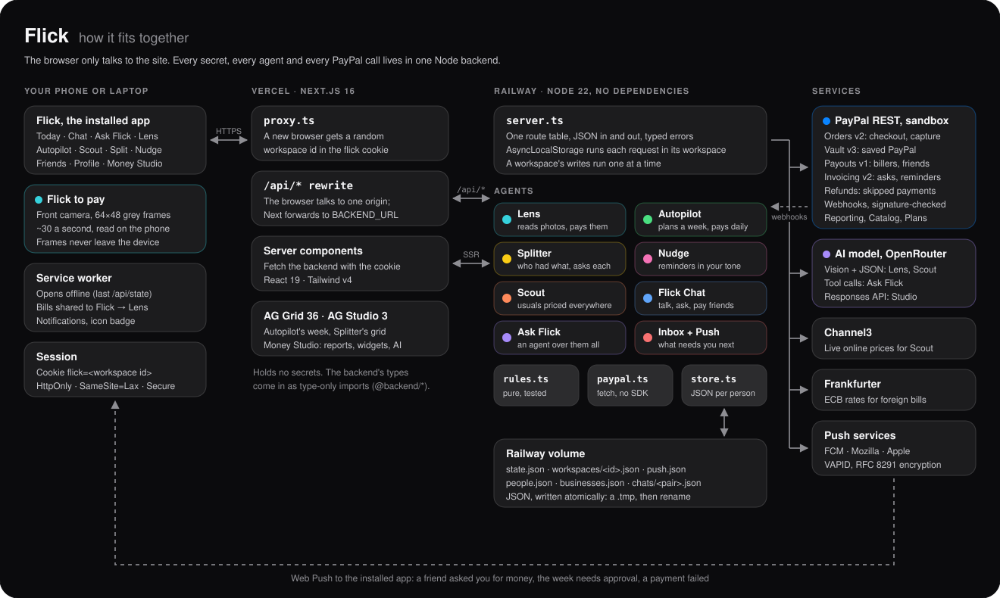

# Flick partner evidence

### Three integrations. One payments app run by AI agents.

| Partner | The role it plays in Flick | Judge-ready evidence |
|---|---|---|
| **[PayPal](paypal.md)** | Every payment: checkouts, saved PayPal, payouts to whoever is owed, invoices to friends, refunds, verified webhooks and reporting. | The live app on the sandbox, the eight PayPal APIs mapped to source, and tests that pay on PayPal's real approval page. |
| **[AG Grid and AG Studio](ag-grid.md)** | Autopilot's editable week, Splitter's who-had-what grid, Scout's price grid, and Money Studio, a themed AG Studio with two custom widgets and Studio's AI assistant. | Every grid and Studio feature mapped to source, in both themes, with the AI behind a key-holding proxy. |
| **[Channel3](channel3.md)** | Scout's real online prices: live offers for your usual groceries, cheapest first, with buy links. | A live call from the deployed backend, and the code that filters and caches it. |

Each page answers the same four questions:

~~~text
What did Flick build with this partner?
Why is it load-bearing rather than decorative?
What can a judge inspect live or in source?
What does the integration never do on its own?
~~~

The last question is Flick's rule for every partner: **AI reads and proposes, rules check, a person
approves, and PayPal moves the money.** No model ever sets an amount, chooses who's paid, or pays
anything on its own.

[Back to the main README](../README.md) · [Open Flick](https://www.flickit.site) · [Backend](../backend/) · [Frontend](../frontend/)
