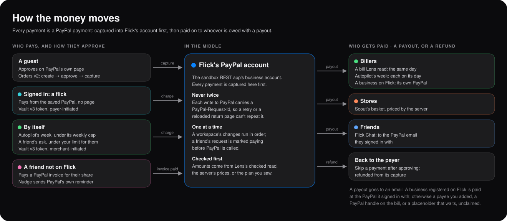

<div align="center">

# Flick × PayPal

### Flick the camera at something and it's paid, on PayPal.

[](../backend/src/paypal.ts)
[](../backend/src/account.ts)
[](../backend/src/autopilot.ts)
[](../backend/src/split.ts)
[](../backend/src/webhooks.ts)

**PayPal is where every Flick payment happens. The agents read, plan and propose; a person says
yes with a flick of a finger; PayPal moves the money.**

</div>



> **Tracks:** Best Overall · Best Use of PayPal + AI · Best Use of Agentic Commerce · Most Creative · Most Impactful · Best Demo Delivery

Flick is a payments app run by five AI agents. Lens reads a bill from a photo, a PDF or an e-mail.
Autopilot runs the week's payments on one approval. Splitter and Flick Chat get friends to pay you
back, and Nudge reminds them. Scout buys your usual groceries where they're cheapest. Ask Flick
plans across all of them, typed or spoken. Every one of those ends in a real PayPal call on the
sandbox: eight PayPal APIs, called with plain `fetch` from a backend with no dependencies.

## Why Flick Wins Each PayPal Prize

| Prize | Why Flick |
|---|---|
| **Best Overall** | A complete product, not a proof of concept: installable on a phone, five agents and a chat, eight PayPal APIs, verified webhooks, and every flow tested with real sandbox payments. |
| **Best Use of PayPal + AI** | AI and PayPal each do the part they're good at. A vision model turns a bill into strict JSON; rules check it; PayPal's Orders, Vault and Payouts pay the right account. AI never sets an amount or a payee. |
| **Best Use of Agentic Commerce** | The agents act, within limits a person sets. Autopilot pays the week by itself under a weekly cap, with merchant-initiated Vault charges. Scout prices and buys a basket. Ask Flick plans across every agent, and each action waits for approval. |
| **Most Creative** | Paying is a gesture: one finger flicked up at the front camera, detected on the phone, charges your saved PayPal. A bill names a business, and Flick pays that business's own PayPal. |
| **Most Impactful** | It removes the typing from paying: retyping bills, chasing friends, watching grocery prices, remembering the same payments every week. It's built for households, flatmates and friends, and for the small businesses they pay. |
| **Best Demo Delivery** | The live site needs no sign-up (each browser gets its own Flick), installs from a QR code, and the video shows each problem, then the agent that fixes it. |

A project can win one PayPal prize and one sponsor prize. Flick's sponsor entries are
[AG Grid](ag-grid.md) and [Channel3](channel3.md).

## What We Built

One bill, end to end:

```
A photo, PDF or e-mail of a bill → Lens reads it (vision model, strict JSON schema)
  → rules.ts checks it → who's paid: a business on Flick, or a payee you know
  → a flick at the front camera
  → PayPal: an order captured, or a charge to your saved PayPal (Vault)
  → a Payout to the biller the same day → Autopilot learns it
  → next week's plan, unusual payments flagged
  → one approval for the week, or paid by itself under the cap
```

The sandbox app's own account plays Flick, in the middle: every payment is captured into it, then
paid on to whoever is owed with a Payout. That one design lets a single approval cover a week of
payments to different people, and lets friends pay each other inside Flick.

## PayPal APIs Used

Every call goes through [`paypal.ts`](../backend/src/paypal.ts): OAuth, retries and a request id on
every call that moves money, so nothing is paid twice.

| API | Calls | Used for |
|---|---|---|
| **Orders v2** | `POST /v2/checkout/orders`, `…/{id}/capture` | Every checkout: bills, the week, baskets. A charge to a saved PayPal is an order with a `vault_id` |
| **Vault v3** | `POST /v3/vault/setup-tokens`, `/payment-tokens`, `DELETE …/payment-tokens/{id}` | Signing in with PayPal, flicks that pay at once, Autopilot and Flick Chat paying by themselves |
| **Payouts v1** | `POST /v1/payments/payouts` | Paying billers, businesses, stores and friends from Flick's account |
| **Invoicing v2** | `POST /v2/invoicing/invoices`, `…/send`, `…/remind`, `GET …/{id}`, list | Asking friends who aren't on Flick, PayPal's own reminders, and who has paid |
| **Payments v2** | `POST /v2/payments/captures/{id}/refund` | A payment skipped after the week was approved |
| **Webhooks** | `POST /v1/notifications/verify-webhook-signature` | Checking each event really came from PayPal |
| **Reporting v1** | `GET /v1/reporting/transactions`, `/balances` | Money Studio |
| **Catalog and Billing** | `GET /v1/catalogs/products`, `GET /v1/billing/plans` | Money Studio |

## Agentic Commerce, with a Person in Charge

| Agent | Does on its own | Waits for a person | PayPal |
|---|---|---|---|
| **Lens** | Reads the bill, converts its currency, finds who's paid | The flick that pays | Orders, or a Vault charge (payer-initiated), then a Payout |
| **Autopilot** | Plans the week from what you've paid; flags what's unusual; pays under the weekly cap you set | One approval for the week, above the cap | An order that saves PayPal, Vault charges (merchant-initiated), a Payout batch each day, refunds |
| **Scout** | Learns your usuals, prices them at every store, sees prices rising | Buying the basket | An order priced by the server, a capture, a Payout to the store |
| **Splitter** | Works out who had what, to the cent | Sending the requests | An invoice to each friend not on Flick, or a request in Flick Chat |
| **Nudge** | Drafts a reminder in the tone you pick | Sending it | PayPal's own invoice reminder |
| **Flick Chat** | Pays a friend's request under the limit you allowed them | Any other request | A Vault charge, then a Payout to the friend |
| **Ask Flick** | Reads your week, bills, friends and groceries | Each of its nine actions, as a card | Through the agents above |

**What no agent ever does:** set an amount, choose who's paid, or move money without a person's
yes or a limit that person set. Amounts come from rules on the server, never from the model or the
browser. Who's paid comes from your payees or a registered business, never from the model.

## How We Meet the Criteria

**Technological implementation.** Eight PayPal APIs, both kinds of Vault charge (payer-initiated on a
flick, merchant-initiated for Autopilot and Flick Chat), and webhooks that are verified with PayPal,
routed to the right person's Flick with no cookie, and applied once. Proven by 49 backend and 8
frontend unit tests, 77 API steps against the real sandbox and model, and 74 browser steps that pay
on PayPal's real approval page, with a flick, and by themselves.

**Design.** A whole product: it installs on a phone from a QR code, works phone-first in light and
dark, takes bills shared from other apps, sends notifications, and shows what needs you next on
Today.

**Potential impact.** Everyone has bills, a group dinner and a weekly shop. Flick turns each into a
snap, a sentence or one weekly approval, and pays businesses straight to their own PayPal.

**Innovation.** A payment confirmed by a gesture read on the phone, with no frame leaving it.
Agents that learn from what you've actually paid. A registry that turns the name on a bill into a
PayPal account.

**Presentation.** A 30-second intro video, a demo, and a live site anyone can open without signing
up.

## Live Evidence

| Surface | Evidence |
|---|---|
| **App** | [www.flickit.site](https://www.flickit.site), and [installing it](https://www.flickit.site/install) on a phone |
| **Backend** | [flick-backend-production.up.railway.app/api/health](https://flick-backend-production.up.railway.app/api/health) |
| **Webhooks** | `POST /api/paypal/webhook`, subscribed in the sandbox app. A forged event is turned away: "invalid signature" |
| **Real payments** | `npm run e2e` pays a bill on PayPal's page, a bill with a flick from a saved PayPal, a Flick Chat request with a flick, and one by itself, each paid out |
| **Every feature on** | `npm run check` tries sign-in, Orders, Payouts, Invoicing, Transaction Search and the AI, and says what to switch on |

## Source Code

| File | Purpose |
|---|---|
| [`backend/src/paypal.ts`](../backend/src/paypal.ts) | Every PayPal call: OAuth, retries, request ids |
| [`backend/src/checkout.ts`](../backend/src/checkout.ts) | A checkout on PayPal's page, or a flick from the saved PayPal |
| [`backend/src/account.ts`](../backend/src/account.ts) | Signing in with PayPal: one Vault approval says who you are and how you pay |
| [`backend/src/autopilot.ts`](../backend/src/autopilot.ts) | One approval a week, a Payout batch each day, refunds |
| [`backend/src/split.ts`](../backend/src/split.ts), [`nudge.ts`](../backend/src/nudge.ts) | Invoices to friends, and PayPal's own reminders |
| [`backend/src/chat.ts`](../backend/src/chat.ts) | Friends paying each other: a Vault charge, then a Payout |
| [`backend/src/business.ts`](../backend/src/business.ts) | Businesses paid at the PayPal they signed in with |
| [`backend/src/webhooks.ts`](../backend/src/webhooks.ts) | Verified, routed, applied once |
| [`backend/src/rules.ts`](../backend/src/rules.ts) | The pure rules every payment depends on (tested) |
| [`frontend/lib/flick.ts`](../frontend/lib/flick.ts) | The flick gesture, read in the browser (tested) |

## Product Feedback for PayPal

### What worked well

- **Vault v3 made signing in and paying one step.** One approval saves PayPal and tells us who the person is, so every later flick pays with no page.
- **Request ids made retries safe.** Every capture, charge, payout and invoice carries one, so a retried request never pays twice.
- **Invoicing's own reminders** meant Nudge needed no e-mail service of its own.
- **Payouts** made "Flick in the middle" possible: one approval in, many payments out.

### Where we lost time

- **An Indian business sandbox account can't send Payouts.** We moved the app to a US business account. A clear error saying so would have saved an evening.
- **Turning on a feature didn't apply until the cached OAuth token was replaced.** `npm run check` now revokes it first.
- **List endpoints return summaries.** Products have no type, plans no billing cycles, invoices no items or payments, so each record is fetched again in full.
- **Transaction Search** covers 31 days a request, rejects fractional seconds, and can take three hours to show new activity.
- **There's no way to check whose account an e-mail is**, or to read a signed-in customer's balance. Flick's profile shows money through Flick instead.

### Suggestions

- A lookup that says whether an e-mail is a PayPal account, before an invoice or a payout goes to it.
- A `full=true` option on list endpoints.
- Sandbox feature changes that apply to existing tokens.

## Future Plans with PayPal

1. **Onboard businesses with PayPal's partner onboarding**, so a business on Flick is paid directly instead of through Flick's account.
2. **Venmo** for friends in the US, inside Flick Chat.
3. **PayPal's Agent Toolkit** behind Ask Flick's tools, so more of PayPal is one approval away.
4. **Live, not sandbox**, once a payments partner reviews the money flow.

## Why Flick and PayPal

Most money apps put AI in a chat box beside the same forms. Flick lets the AI do what it's good at,
reading the world and planning, and lets PayPal do what it's good at, moving money that people
trust. Every payment is a PayPal payment, approved by a person or by a limit that person set. That
is why Flick can let agents act without asking anyone to trust the agents with their money.

[Back to partner evidence](README.md) · [Main README](../README.md)
